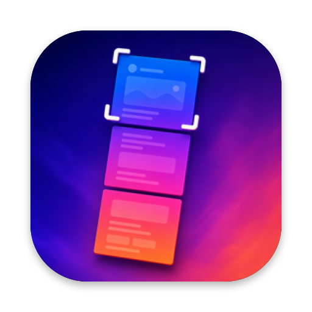

  

# Long Screenshot

Scrolling screenshots for macOS.

Set a global shortcut, select a scrollable area in any app, then scroll downward to create one seamless image.

## Features

- **Capture beyond the viewport** — select an area, scroll down slowly, and the frames are stitched into a single PNG.
- **Live preview** while you scroll.
- **Global keyboard shortcut** to start a capture from anywhere.
- **Clothesline** — finished long screenshots hang on a clothesline where you can copy, mark up, show in Finder, or move them to the Trash.
- Available in English, 简体中文, 日本語, and 한국어.

## Requirements

- macOS 26.0+
- Screen Recording permission (macOS asks the first time you capture)

## Install

Download the ZIP from [Releases](../../releases).

## Quick Start

1. Open Long Screenshot and choose a save folder.
2. Record a keyboard shortcut.
3. Press the shortcut, select the area to capture, and press **Start**.
4. Scroll down slowly, keeping each new frame overlapping the previous one, then press **Done**.

## Links

- [Privacy Policy](https://oneclick-inc.github.io/LongScreenShot/)
- [License](LICENSE)

The clothesline is adapted from [Tendedero](https://github.com/alejandrobujan/tendedero) by Alejandro Buján, used under the MIT License.
